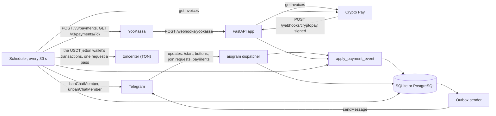
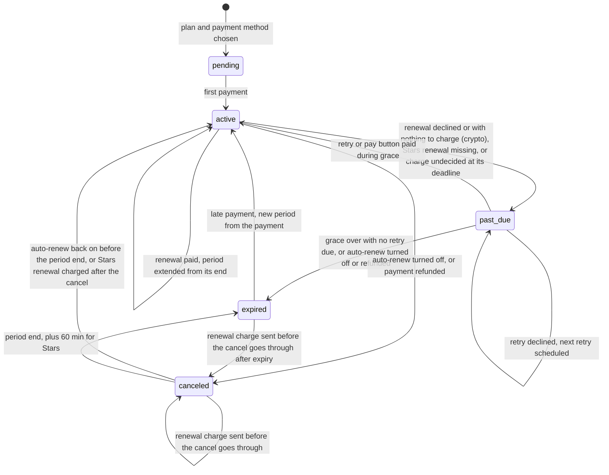
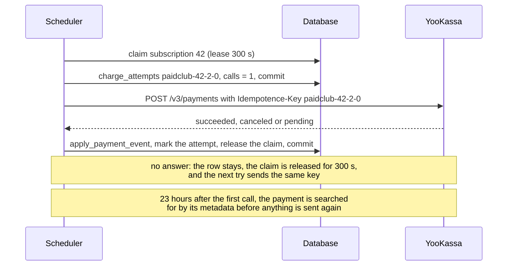

# Architecture

One process runs four things on one asyncio loop ([`runner.py`](../src/paidclub/runner.py)): the
aiogram dispatcher (polling or webhook), the FastAPI app (payment webhooks, the checkout pages,
`/admin`, `/paid`, `/healthz`), the scheduler and the outbox sender. They share one database and one
`Core` ([`container.py`](../src/paidclub/container.py)): settings, the session factory, the clock,
the provider registry and the billing policy.

Every source of payment facts (a webhook, a renewal charge, a Telegram Stars update, a lookup of a
checkout, USDT found in the owner's TON wallet) produces a `PaymentSucceeded` or `PaymentFailed` event, and every event goes through
`apply_payment_event` in [`payments.py`](../src/paidclub/payments.py). That function is the only
code that changes a subscription because of money. The state changes themselves are pure functions
in [`domain/subscriptions.py`](../src/paidclub/domain/subscriptions.py): they take the current state
and "now" and return the next state, without touching the database or the clock.

All times are UTC. Everything that reads "now" goes through a `Clock`
([`clock.py`](../src/paidclub/clock.py)); tests and `paidclub simulate` pass a `FakeClock` that
moves only when told to.

## Subscription states

| From | To | When | Function |
| --- | --- | --- | --- |
| — | `pending` | The member picks a plan and a payment method. The plan's price and period are copied onto the row. | `club.start_checkout` |
| `pending` | `active` | First payment. The anchor is the moment the payment is applied; period 1 ends one plan period later. | `payment_succeeded` |
| `active` | `active` | A renewal is paid. The new period starts where the old one ended. | `payment_succeeded` |
| `active` | `past_due` | A renewal charge was declined, or had nothing to charge (a card that was not saved; crypto, which never has a method); a Stars renewal has not arrived by the period end plus `stars_renewal_wait_minutes`; or a charge is still undecided at its deadline. Grace runs from the period end. | `charge_failed`, `charge_unsettled` |
| `past_due` | `past_due` | A retry was declined. The grace window stays, the next retry is scheduled. | `charge_failed` |
| `past_due` | `active` | A retry or a payment through the "pay" button (for crypto, a new invoice) went through. | `payment_succeeded` |
| `past_due` | `expired` | Grace is over and no retry is due (reason `payment_failed`), or the member turned auto-renew off, or the payment was refunded (reason `canceled`). | `expire`, `cancel` |
| `active` | `canceled` | Auto-renew turned off, or a refund in the YooKassa dashboard. Access stays until the period end. | `cancel` |
| `canceled` | `active` | Auto-renew turned back on before the period end. For Stars only when a renewal charged after the cancel arrives, which means the member re-enabled it in Telegram. | `resume`, `payment_succeeded` |
| `canceled` | `canceled` | A renewal charge sent before the cancel goes through. It pays the next period, and auto-renew stays off. | `payment_succeeded` |
| `canceled` | `expired` | The paid period is over (reason `canceled`). Stars subscriptions wait `stars_renewal_wait_minutes` longer. | `expire` |
| `expired` | `active` | A payment on an expired subscription, from the "pay" button or a new Stars or Crypto Pay invoice. The anchor moves to the payment. | `payment_succeeded` |
| `expired` | `canceled` | A renewal charge sent before a cancel goes through after the subscription expired, while the period it pays for is still running. If that period is already over, the payment is flagged for a refund instead. | `payment_succeeded` |

`active`, `past_due` and `canceled` are live statuses: a member has at most one live subscription (a
partial unique index). Who may be in a club chat (`has_access`):

| Status | Access |
| --- | --- |
| `pending` | no |
| `active` | yes, also after the period end while the renewal is being charged |
| `past_due` | until `grace_until` |
| `canceled` | until `current_period_end` |
| `expired` | no |

The owner (`PAIDCLUB_OWNER_ID`) and the ids in `PAIDCLUB_ADMIN_IDS` are let in without a
subscription and never removed.

### Periods

A subscription stores an anchor (`anchor_at`, `anchor_periods`) and counts paid periods
(`periods_paid`). Period n ends at `anchor_at + (n − anchor_periods) × plan period`, so a renewal
never starts from "now". Month arithmetic clamps to the last day of a shorter month and comes back:
anchored on 31 January, the periods end on 28 February, 31 March, 30 April, 31 May. The anchor moves
only when access had ended (a first payment, or a payment after expiry); then the new period starts
at the payment. Stars is the exception: Telegram decides the period end, and
`subscription_expiration_date` is taken as is. A crypto period paid early, from the reminder,
starts at the end of the current one like a renewal does, so paying ahead loses no days.

A monthly YooKassa subscription paid on 31 January 2026 at 09:00 UTC, with the default settings, the
card declined at every renewal, and scheduler passes on time:

| When (UTC) | What happens | Key |
| --- | --- | --- |
| 31 Jan 09:00 | First payment, period 1 ends 28 Feb 09:00 | `activated:1:1` |
| 25 Feb 09:00 | Reminder, 3 days before | `reminder:1:20260228T090000Z:3d` |
| 27 Feb 09:00 | Reminder, 1 day before | `reminder:1:20260228T090000Z:1d` |
| 28 Feb 09:00 | Renewal charge, attempt 0, declined. `past_due`, grace until 3 Mar 09:00, next retry 1 Mar 09:00 | `paidclub-1-2-0`, `payment_failed:1:2:0` |
| 1 Mar 09:00 | Retry, attempt 1, declined. Next retry 3 Mar 09:00 | `paidclub-1-2-1`, `payment_failed:1:2:1` |
| 3 Mar 09:00 | Retry, attempt 2, declined; no retries left. In the same pass the subscription expires and the member is removed | `paidclub-1-2-2`, `expired:1:1` |

The third "payment failed" message (`payment_failed:1:2:2`) is enqueued as well, but its deadline is
the end of grace, so the outbox drops it as stale and the member gets the "access ended" one. Had
the retry on 1 March gone through, period 2 would have run from 28 February to 31 March, not from 1
March. The retry on 3 March is due at the same moment grace ends; renewals run before expiry in a
pass, so it gets its chance.
`tests/test_scheduler.py::test_a_declined_card_goes_through_dunning_and_then_loses_access` walks
this path.

## Tables

[`models.py`](../src/paidclub/models.py). Every timestamp goes through `UTCDateTime`, which stores
UTC and gives back aware datetimes on SQLite too. The schema is created with `create_all`; there are
no migrations.

| Table | What it holds | Constraints that carry a guarantee |
| --- | --- | --- |
| `members` | Telegram users who wrote to the bot or sent a join request; `bot_blocked_at` after a 403 | `telegram_id` unique |
| `club_chats` | Each club chat with its one join-request invite link | `chat_id` primary key |
| `subscriptions` | Status, plan snapshot (price, currency, period), anchor and period fields, dunning state, saved payment method (YooKassa method id or the first Stars charge id), lease columns | `version` optimistic lock; partial unique index on `member_id` where the status is live; indexes on `(status, next_charge_at)` and `(status, current_period_end)` |
| `subscription_events` | Every status change, written by a `before_flush` hook whichever code made it; stats and churn come from here | — |
| `payments` | Every payment event, applied or not, with its outcome (`applied`, `recorded`, `stale`, `needs_refund`, `amount_mismatch`, `unknown_subscription`) | `(provider, provider_payment_id)` unique; partial unique index on `(subscription_id, for_period)` where `status = succeeded` and `applied` |
| `refunds` | Refunds made in the YooKassa dashboard | `(provider, refund_id)` unique |
| `charge_attempts` | One row per renewal charge, written before the provider call: `started`, `pending`, `succeeded`, `failed`, number of calls, last error, next lookup | `idempotence_key` unique; `(subscription_id, for_period, attempt)` unique |
| `checkouts` | Payments a provider created for a checkout link (a YooKassa payment, a Crypto Pay invoice), looked up until decided | `(provider, provider_payment_id)` unique |
| `stars_payment_updates` | Each Telegram Stars `successful_payment` as it arrived, stored before it is applied | `telegram_payment_charge_id` unique |
| `stars_payments`, `stars_refunds` | aiogram-stars' records: each Stars charge with how it was handled, and the refunds it sends | `charge_id` primary key in both |
| `ton_invoices` | What a member was asked to send to the owner's TON wallet: the price in USDT units, a comment unique to the checkout, what arrived so far, `open`, `paid` or `expired` | `comment` unique; `version` optimistic lock |
| `ton_transfers` | Every USDT credit to the owner's jetton wallet that the poll found, with its invoice or none | `tx_hash` unique |
| `ton_wallets` | The owner's USDT jetton wallet as the master gave it, pinned, with the logical time read up to and when it was last polled | `(owner_address, jetton_master)` unique |
| `notifications` | The outbox: rendered text, buttons, status, attempts, `not_after`, lease columns | `key` unique |
| `access_events` | Every join decision and removal attempt: approved, declined, failed, removed, removed on join, not a participant, skipped admin, skipped (has access), no rights, error | — |

## One scheduler pass

[`scheduler.py`](../src/paidclub/scheduler.py). `Scheduler.tick()` runs every
`PAIDCLUB_SCHEDULER_INTERVAL_SECONDS` (30 s). Each step takes batches of 50 rows, up to 100 batches,
and runs in its own `try`, so one failing step does not stop the others. Several processes can run
passes on one database at the same time; how they split the work is under
[Concurrency](#concurrency).

1. **Renewals.** Claims `active` and `past_due` subscriptions whose `next_charge_at` has come,
   oldest first, with a lease of `PAIDCLUB_CLAIM_LEASE_SECONDS`. For each one:
   - A Stars subscription is not charged: Telegram charges it. Its `next_charge_at` is the period
     end plus `stars_renewal_wait_minutes`, and if the renewal has not arrived by then, it goes
     `past_due` without retries and the member is told.
   - A Crypto Pay subscription has nothing to charge. It goes through the steps below, but the
     provider answers `no_saved_payment_method` at once, without a request, so it goes
     `past_due` with grace, and each retry date only sends the member the pay button again.
     Members who pay ahead, from the reminder, never reach this step for that period.
   - Otherwise, in one transaction, the `charge_attempts` row for
     `paidclub-<subscription>-<period>-<attempt>` is created (or found) and its call count raised,
     and that is committed. A row already `pending` is left to step 2. A row whose earlier calls
     never got an answer is given up at its deadline (the end of the grace period the member would
     have had, and at least 6 hours after the first call): the subscription goes `past_due` with no
     further charge, and the owner is alerted.
   - The provider call runs outside any transaction. A `ProviderError` (timeout, 429, 5xx) keeps the
     row and releases the claim for `PAIDCLUB_PROVIDER_RETRY_SECONDS`; the next try sends the same
     key. After 3 calls without an answer the owner is alerted.
   - The answer is applied in a second transaction through `apply_payment_event`, and the claim is
     released. A `pending` answer marks the row `pending` and sets its next lookup.
2. **Pending charges.** `charge_attempts` rows in `pending` whose `next_check_at` has come are
   looked up with the provider's `check_payment` (YooKassa: `GET /v3/payments/{id}`) every
   `PAIDCLUB_PENDING_RECHECK_SECONDS`, until decided. This runs per charge, not per subscription, so
   a charge that settles after the member cancelled is still recorded.
3. **Checkouts.** Checkout payments whose notification has not arrived are looked up 5 minutes after
   the link was made, every 15 minutes for two hours, then hourly, and given up after 48 hours
   ([`checkouts.py`](../src/paidclub/checkouts.py)). If a lookup applies a successful payment, the
   owner is told to check the notification URL. A Crypto Pay invoice expires unpaid after
   `PAIDCLUB_CRYPTOPAY_INVOICE_LIFETIME_MINUTES` (at most a day), and the lookup that sees it
   `expired` records a failed checkout.
4. **Stars updates.** `stars_payment_updates` rows still `pending` are applied again, with waits
   doubling from 1 minute to an hour, 12 times; then the row is `failed` and the owner is alerted.
5. **USDT on TON** ([`ton_payments.py`](../src/paidclub/ton_payments.py)). Open TON invoices whose
   time is up become `expired`, and one that expired partly paid is reported to the owner and the
   member. Then, if an invoice is open, the owner's USDT jetton wallet is read once, at most every
   `PAIDCLUB_TON_POLL_SECONDS`; if one was paid or expired in the last week, every 5 minutes;
   otherwise not at all. The very first poll asks the USDT master for the jetton wallet's address
   (`get_wallet_address`) and pins it in `ton_wallets` instead. Each successful `internal_transfer`
   into that wallet is stored by its hash, added to the invoice with its comment, and applied
   through `apply_payment_event` once the invoice's transfers reach the price. The cursor moves
   only past transactions of that wallet.
6. **Expiry.** `past_due` subscriptions whose grace is over and that have no retry due, and
   `canceled` ones whose period is over (Stars: plus `stars_renewal_wait_minutes`), become
   `expired`, and the member is told.
7. **Removal.** Expired subscriptions with no `access_revoked_at` are claimed. If the member is the
   owner or an admin, or already has access through another subscription, nothing is done. Otherwise
   every club chat gets `getChatMember`, `banChatMember(until_date=now + 10 min)` and
   `unbanChatMember(only_if_banned=True)` ([`bot/revoker.py`](../src/paidclub/bot/revoker.py)). "Not
   a participant", "is an admin" and "not enough rights" are final answers; network errors and 5xx
   are not, and the subscription is tried again after `PAIDCLUB_PROVIDER_RETRY_SECONDS`.
   `access_revoked_at` is set only when every chat gave a final answer. Missing rights alert the
   owner once a day per chat, and those removals are queued again when the bot gets its rights back.
8. **Reminders.** For `active` and `canceled` subscriptions whose period ends within the largest
   reminder offset, the closest offset that has passed is enqueued. A worker that was down during
   the 3-day window sends only the 1-day reminder, and an offset that would fall before the period
   start is skipped.

Renewals come before expiry on purpose: a last retry due exactly when grace ends is charged before
the subscription can expire.

### The outbox

[`notifications.py`](../src/paidclub/notifications.py). Code that changes a subscription enqueues
its message in the same transaction with `INSERT … ON CONFLICT (key) DO NOTHING`, so a message
exists exactly when the change was committed, and a key is enqueued once. Text is rendered when the
message is enqueued, so a later change of the copy does not touch messages already waiting.

`OutboxSender` runs in its own loop. It claims up to `PAIDCLUB_OUTBOX_BATCH_SIZE` pending rows with
a lease, oldest first, and sends them with `sendMessage`
([`bot/sender.py`](../src/paidclub/bot/sender.py)):

| Telegram answers | Row | Next |
| --- | --- | --- |
| OK | `sent` | — |
| 429 with `retry_after` | unchanged, no attempt counted | this row and the rest of the batch wait `retry_after` seconds |
| 403, "chat not found", "user is deactivated" | `undeliverable`, member gets `bot_blocked_at` | — |
| any other error | attempt counted | retried after 30 s, doubling up to 1 h; `failed` after `PAIDCLUB_OUTBOX_MAX_ATTEMPTS` |
| — (`not_after` has passed) | `stale` | a reminder about a date that is already over is dropped |

The loop sleeps one second when there is nothing to send.

## Idempotency keys

| What | Key | Enforced by | A repeat |
| --- | --- | --- | --- |
| A provider payment | `(provider, provider_payment_id)`: the YooKassa payment id, the Crypto Pay invoice id, the Telegram charge id, the fake payment id | unique constraint on `payments` | answered as `duplicate`, nothing written. One exception: a payment recorded as failed that later reports success is upgraded, because money moved |
| A paid period | `(subscription_id, for_period)` | partial unique index on applied successful `payments` | a second payment for a paid period is recorded as `needs_refund`, and the owner is alerted |
| A renewal charge | `paidclub-<subscription>-<period>-<attempt>`, attempt 0 for the regular renewal, 1 and 2 for retries | unique `charge_attempts.idempotence_key`; sent as YooKassa's `Idempotence-Key` header | YooKassa returns the first answer for 24 hours; after 23 hours the app searches `GET /v3/payments` for its metadata instead of sending again |
| A checkout payment | a random UUID per checkout as `Idempotence-Key`; then `(provider, provider_payment_id)` | unique constraint on `checkouts` | the same key is reused once after a 5xx or a timeout; tapping "pay" twice makes two payment pages, and the second payment for the period is caught by the paid-period key |
| A crypto period | the period in the invoice payload `paidclub:<subscription>:<period>` | paid-period key | a second invoice paid for the same period (the member tapped "pay" twice) is `needs_refund`, and the owner sends the coins back from @CryptoBot |
| A TON transfer | the hash of the transaction that credited the owner's USDT jetton wallet | unique `ton_transfers.tx_hash`, written in the same transaction as what the transfer causes | stored and counted once, also when the indexer returns it again, a worker reads it twice, or the cursor was not saved before a crash |
| A TON invoice | its comment, which is also the payment id | unique `ton_invoices.comment`, then `(provider, provider_payment_id)` and the paid-period key | applied once, when its transfers reach the price; a transfer with its comment after that is reported to the owner as money to return |
| A Stars update | `telegram_payment_charge_id` | primary key of aiogram-stars' `stars_payments`, then unique `stars_payment_updates.telegram_payment_charge_id` | handed to the club once, stored once, applied once |
| A Stars first payment | the period in the signed invoice payload `<subscription>:<period>.<signature>` (`paidclub:<subscription>:<period>` before signing) | paid-period key | a second Telegram subscription bought from the same invoice is `needs_refund`, and it is cancelled with `editUserStarSubscription` |
| A refund | `(provider, refund_id)` | unique constraint on `refunds` | answered as `duplicate` |
| A fake renewal | `fake_r_` + the first 20 hex digits of SHA-256 of the charge key | the fake provider derives the payment id from the key | the same payment id and the same answer |
| A live subscription | `member_id` | partial unique index where the status is live | a member cannot hold two live subscriptions |
| A subscription row | `version` | SQLAlchemy `version_id_col` | the second of two writers that read the same version gets `StaleDataError` and redoes its work on fresh data |
| A message | `notifications.key` | unique constraint | not enqueued again |

The message keys:

| Key | Message |
| --- | --- |
| `activated::<periods paid>` | payment received, join button |
| `renewed::<periods paid>` | renewal paid |
| `reminder::<period end, UTC, %Y%m%dT%H%M%SZ>:<offset, e.g. 3d>` | reminder before a renewal or the end of access |
| `payment_failed::<period>:<attempt>` | renewal failed, pay button; dropped after `grace_until` |
| `expired::<periods paid>` | access ended |
| `refunded:<provider>:<refund id>` | money returned, auto-renew off |
| `ton_underpaid:<invoice>:<units received>` | USDT arrived short of the price: how much came and how much is left |
| `ton_partial_expired:<invoice>` | a partly paid USDT checkout ran out of time; a top-up still counts |
| `owner:…` | alerts to the owner: an unknown subscription, a wrong amount or a payment to refund (per payment), a charge without an answer or given up (per charge key), a Stars payment that never applied (per charge id), a Stars refund that ran out of attempts (per failure), missing rights, chat setup problems, people who joined without access, a provider refusal for the shop's own reasons, a lost notification (once a day each), a join request Telegram never took (once an hour), USDT that matched no checkout, came after its checkout expired, overpaid it or arrived for a paid one, or could not be read (per transaction), a TON checkout that expired partly paid or was overpaid (per invoice), toncenter unreachable (once a day) |

## Concurrency

[`db.py`](../src/paidclub/db.py).

- **Claims.** `claim()` hands rows to one worker at a time. On PostgreSQL the candidates are read
  with `SELECT … FOR UPDATE SKIP LOCKED`. On both backends the claim itself is a conditional
  `UPDATE` that sets `claim_token` and `claimed_until = now + lease` only on rows whose
  `claimed_until` is empty or past, and the worker then reads back which rows carry its token. That
  `UPDATE` is what makes it safe on SQLite. A worker that dies keeps its rows until the lease runs
  out. Renewals, removals and outbox messages are claimed this way.
- **Moving a timestamp as a claim.** Pending charges, checkouts and stored Stars updates are claimed
  by an `UPDATE` that moves their `next_check_at` or `next_attempt_at` forward, conditional on the
  value just read; a second worker's update matches nothing. The TON wallet poll is claimed the
  same way, on `ton_wallets.polled_at`, so two workers make one request.
- **Fenced writes.** The outbox records a result only `WHERE claim_token = <its token>`, and a
  removal sets `access_revoked_at` only while the subscription is still expired and still claimed by
  that worker.
- **Retried transactions.** `in_transaction()` runs a unit of work in its own transaction and starts
  it again on a fresh session after a `StaleDataError` (optimistic lock) or an `IntegrityError` (a
  unique key a concurrent writer took), up to 4 times. After that it raises `ConcurrentUpdateError`,
  and a webhook answers 503 so the provider sends it again.
- **SQLite.** WAL mode and a 30-second busy timeout, so a second writer waits instead of failing
  with "database is locked".

Tests that run these races: `tests/test_db.py::test_two_concurrent_claims_never_get_the_same_row`,
`tests/test_scheduler.py::test_two_workers_charge_each_renewal_exactly_once`,
`tests/test_payments.py::test_the_same_webhook_delivered_concurrently_is_applied_once`,
`tests/test_outbox.py::test_two_senders_running_together_send_each_message_once`. With
`PAIDCLUB_TEST_DATABASE_URL` set they run on PostgreSQL.

## Where a crash can land

| The process dies… | What happens next |
| --- | --- |
| after committing the `charge_attempts` row, before or during the provider call | the lease runs out, another pass claims the subscription and sends the same key; YooKassa answers with the first result if the first call reached it |
| after the provider answered, before the answer was recorded | the same: the repeated key gets the recorded answer back |
| more than 23 hours later, still without an answer | the payment is searched for by metadata; only if none of the earlier calls created one is the charge sent again |
| between `banChatMember` and `unbanChatMember` | the ban ends by itself after 10 minutes; the retry finds a short ban it recognises as its own and lifts it at once. A ban without such an end was set by an admin and is left alone |
| after Telegram accepted a message, before it was marked sent | the message is sent again once its lease runs out: the one place that is at least once rather than once |
| while a Stars `successful_payment` is being applied | the update is already in `stars_payment_updates`; the scheduler applies it |
| with the database down when a Stars payment arrives | aiogram-stars records the charge in `stars_payments`, then the club stores the update; each write is tried 4 times. If either still fails, the owner gets a direct Telegram message with the charge id, outside the outbox, and the payment is logged at CRITICAL |
| before a YooKassa checkout notification was handled | YooKassa sends it again for 24 hours, and the scheduler looks the payment up anyway |
| before a Crypto Pay webhook was handled | the scheduler looks the invoice up with `getInvoices` |
| after reading the TON wallet, before saving how far it read | the next poll reads the same transactions again; each is stored by its hash, so none counts twice |

## Stats

[`stats.py`](../src/paidclub/stats.py) defines every number on `/stats` and `/admin` once. The
current counts and MRR come from `subscriptions`; everything over a period (new, renewals,
cancellations, churn, failed charges, revenue) comes from `subscription_events` and `payments`,
bucketed by calendar day or month in `PAIDCLUB_DISPLAY_TIMEZONE`. Buckets are filled in Python
rather than with SQL date functions, because SQLite has no time zone support, and so the daily rows
add up to the totals exactly. MRR counts `active` and `past_due` subscriptions, each price divided
by its length in months (30 days count as one month); rubles, Stars and dollars are never added
together.
Revenue is gross: refunds are recorded, not subtracted. Churn rate is the number of subscriptions
that expired in the window divided by the number that had access at some point in it.
